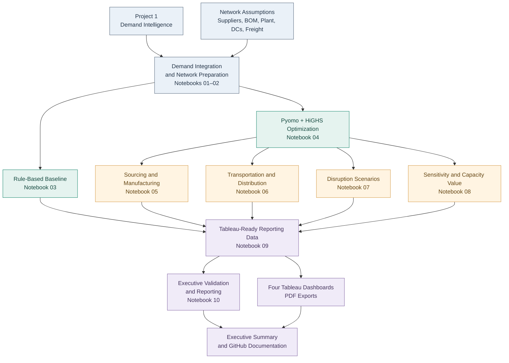
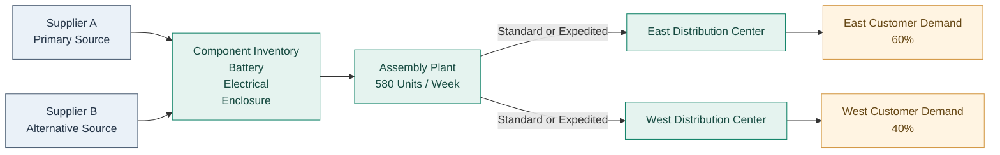

# End-to-End Hardware Supply Network Optimizer

**Hardware Supply Chain Optimization | Operations Research | Decision Analytics**

An end-to-end supply network optimization project integrating demand planning, supplier sourcing, manufacturing, inventory management, transportation, and distribution using Python, Pyomo, HiGHS, DuckDB, and Tableau.

---

## 1. Project Overview

This project develops a 12-week supply chain optimization framework for a hypothetical hardware manufacturer.

Building on demand intelligence from my previous **Hardware Demand-Sensing & Launch Readiness Planner** project, the framework translates demand requirements into coordinated sourcing, manufacturing, transportation, inventory, and distribution decisions.

The project compares a rule-based baseline supply plan against a mathematically optimized network to evaluate cost efficiency, operational constraints, supply chain resilience, and opportunities for targeted capacity expansion.

**Project objectives:**

- Minimize total network operating costs.
- Coordinate supplier procurement and manufacturing decisions.
- Optimize transportation and distribution allocation.
- Maintain customer demand fulfillment.
- Evaluate the financial impact of operational disruptions.
- Identify capacity bottlenecks and economically valuable expansion opportunities.
- Translate optimization outputs into executive decision-support dashboards.

> **Important:** This project uses hypothetical supply network parameters and operating assumptions. All reported improvements are modeled results, not realized financial savings.

---

## 2. Executive Results

| Performance Metric | Result |
|---|---:|
| Baseline Network Cost | $414,139.70 |
| Optimized Network Cost | $404,131.20 |
| **Total Modeled Savings** | **$10,008.50** |
| **Network Cost Reduction** | **2.42%** |
| Transportation Savings | $8,900.00 |
| Transportation Cost Reduction | 25.76% |
| Customer Demand Fulfilled | 100% |
| Supplier A Sourcing Share | 89.5% |
| Total Finished-Goods Production | 5,665 units |
| Planning Horizon | 12 weeks |

### Primary Outcome

The optimized network achieved a **2.42% reduction in modeled operating costs** relative to the rule-based baseline while maintaining **100% customer demand fulfillment** under the reference planning assumptions.

Transportation optimization contributed the largest positive cost savings, while sensitivity experiments revealed supplier concentration and demand scalability constraints.

---

## 3. Business Problem

Hardware manufacturers must continuously balance cost, service levels, material availability, manufacturing capacity, and transportation constraints.

These decisions are closely interconnected.

A lower-cost supplier may have longer lead times. Expedited freight may improve material availability but increase operating expenses. Manufacturing capacity can constrain fulfillment even when sufficient component supply exists.

The challenge is determining the best combination of sourcing, production, inventory, and transportation decisions across the entire network.

### Key Business Questions

1. Which suppliers should fulfill component requirements?
2. How should procurement quantities account for supplier capacity and lead times?
3. When and how much should the manufacturer produce?
4. How should finished goods be allocated across regional distribution centers?
5. When should standard versus expedited freight be used?
6. How much do operational disruptions increase network costs?
7. Which capacity expansions offer the greatest modeled economic value?
8. How much demand growth can the current network support?

### Optimization Objective

Develop a constrained mathematical optimization model that minimizes total modeled supply network cost while satisfying material availability, manufacturing, inventory, transportation, and customer demand requirements.

---

## 4. System Architecture

The analytical workflow integrates demand planning, supply network configuration, mathematical optimization, operational analysis, scenario testing, and executive reporting.



### Technology Stack

| Technology | Application |
|---|---|
| Python | Data processing, optimization, and validation |
| pandas / NumPy | Data transformation and analytical calculations |
| DuckDB / SQL | Demand data integration and querying |
| Pyomo | Mathematical optimization model formulation |
| HiGHS | Mixed-integer optimization solver |
| SciPy | Scientific computing support |
| Jupyter Notebook | Analytical workflow and documentation |
| Tableau | Executive dashboards and visual analytics |
| Git / GitHub | Version control and project publication |

---

## 5. Modeled Supply Network

The model represents a hypothetical hardware supply chain containing two suppliers, three component categories, one assembly plant, two distribution centers, and two transportation options.



### Network Configuration

| Element | Description |
|---|---|
| Finished Product | One reference hardware product |
| Component Categories | Battery, Electrical, Enclosure |
| Suppliers | Supplier A and Supplier B |
| Supplier A Capacity | 450 units per component per week |
| Supplier B Capacity | 250 units per component per week |
| Manufacturing Facilities | One assembly plant |
| Manufacturing Capacity | 580 finished units per week |
| Distribution Centers | East and West |
| Transportation Modes | Standard and expedited |
| Planning Horizon | 12 weeks |
| Reference Demand | 6,180 units |
| Regional Demand Split | 60% East / 40% West |

Each finished product requires one unit of each modeled component category.

The optimization coordinates procurement, component availability, production scheduling, finished-goods inventory, transportation, and customer fulfillment.

---

## 6. Optimization Methodology

The analytical workflow consists of ten Jupyter notebooks.

| Notebook | Analytical Focus |
|---|---|
| 01 | Project 1 Demand Integration |
| 02 | Supply Network Data & Configuration |
| 03 | Rule-Based Baseline Supply Plan |
| 04 | Network Optimization Model |
| 05 | Supplier & Manufacturing Constraints |
| 06 | Distribution & Transportation Analysis |
| 07 | Disruption Scenario Analysis |
| 08 | Sensitivity & Capacity Investment Analysis |
| 09 | Tableau Reporting Data Preparation |
| 10 | Executive Summary & Final Validation |

### Mathematical Objective

Minimize total modeled network cost:

\[
\text{Minimize Total Cost} =
\text{Procurement Cost}
+
\text{Manufacturing Cost}
+
\text{Transportation Cost}
+
\text{Inventory Holding Cost}
\]

### Primary Decision Variables

The optimization determines:

- Component purchasing quantities by supplier and week.
- Weekly manufacturing production quantities.
- Component inventory balances.
- Finished-goods inventory balances.
- Transportation shipment quantities by lane, mode, and week.
- Distribution center inventory levels.

### Operating Constraints

The model accounts for:

- Supplier purchasing capacity.
- Supplier lead times.
- Bill-of-materials component requirements.
- Component inventory availability.
- Manufacturing production capacity.
- Transportation lane capacity and transit times.
- Distribution center storage capacity.
- Customer demand fulfillment.
- Inventory flow conservation.
- Terminal inventory requirements.
- Nonnegative integer flow decisions.

The mathematical model is implemented using **Pyomo** and solved with **HiGHS**.

---

## 7. Executive Tableau Dashboards

Four Tableau dashboards translate the analytical results into executive decision-support visuals.

Each dashboard is available as a PDF, allowing results to be reviewed without Tableau Desktop.

| Dashboard | Primary Focus | PDF |
|---|---|---|
| **01 — Network Cost & Optimization Performance** | Financial results, baseline comparison, savings drivers | [View Dashboard 01](outputs/figures/dashboard_01_network_cost.pdf) |
| **02 — Sourcing & Manufacturing Intelligence** | Supplier allocation, procurement, production, capacity | [View Dashboard 02](outputs/figures/dashboard_02_sourcing_manufacturing.pdf) |
| **03 — Transportation & Distribution Intelligence** | Freight modes, shipping costs, DC inventory, fulfillment | [View Dashboard 03](outputs/figures/dashboard_03_transportation_distribution.pdf) |
| **04 — Risk, Scenario & Sensitivity Intelligence** | Disruption costs, capacity investment, demand sensitivity | [View Dashboard 04](outputs/figures/dashboard_04_risk_scenario_sensitivity.pdf) |

### Dashboard 01 — Network Cost & Optimization Performance

Compares the rule-based baseline against the mathematically optimized network.

**Key finding:** The optimization model reduced total modeled network costs by $10,008.50, equivalent to a 2.42% reduction.

[Open Dashboard 01 — PDF](outputs/figures/dashboard_01_network_cost.pdf)

### Dashboard 02 — Sourcing & Manufacturing Intelligence

Analyzes sourcing allocation, supplier utilization, component purchasing, and manufacturing capacity.

**Key finding:** Supplier A accounts for approximately 89.5% of optimized component purchasing, highlighting sourcing concentration risk.

[Open Dashboard 02 — PDF](outputs/figures/dashboard_02_sourcing_manufacturing.pdf)

### Dashboard 03 — Transportation & Distribution Intelligence

Evaluates standard versus expedited freight, transportation costs, inventory movements, and distribution center performance.

**Key finding:** The optimized network reduces modeled transportation costs by $8,900, or 25.76%.

[Open Dashboard 03 — PDF](outputs/figures/dashboard_03_transportation_distribution.pdf)

### Dashboard 04 — Risk, Scenario & Sensitivity Intelligence

Analyzes disruption scenarios, modeled capacity expansion savings, and demand growth feasibility.

**Key finding:** Supplier A offers the largest tested capacity savings, while the network becomes infeasible under the tested +15% and +20% demand-growth cases.

[Open Dashboard 04 — PDF](outputs/figures/dashboard_04_risk_scenario_sensitivity.pdf)

For a consolidated business analysis, see the [Executive Summary](docs/executive_summary.md).

---

## 8. Key Findings

### Finding 1 — Network Cost Optimization

| Metric | Baseline | Optimized |
|---|---:|---:|
| Total Network Cost | $414,139.70 | $404,131.20 |
| Customer Fulfillment | 100% | 100% |

**Result:** $10,008.50 in modeled savings, representing a 2.42% reduction in total network cost.

This demonstrates the value of optimizing procurement, manufacturing, transportation, and inventory decisions together rather than relying solely on a rule-based planning strategy.

### Finding 2 — Transportation Efficiency

Transportation optimization generated **$8,900 in modeled savings**.

The optimized plan improved standard versus expedited freight allocation while satisfying customer fulfillment requirements and the model's operating constraints.

Transportation represented the largest positive contributor to total network savings.

### Finding 3 — Supplier Concentration

Supplier A fulfilled approximately **89.5% of optimized component purchasing**.

Although this allocation supports cost efficiency, it also creates potential exposure to supplier capacity constraints and disruption events.

This finding supports further analysis of dual sourcing, backup capacity, and contingency inventory.

### Finding 4 — Disruption Scenario Analysis

Four hypothetical disruption scenarios were evaluated through network reoptimization.

| Disruption Scenario | Incremental Modeled Cost |
|---|---:|
| Demand Surge | $14,836.50 |
| Supplier Disruption | $13,500.00 |
| Freight Inflation | $9,789.25 |
| Manufacturing Disruption | $1,610.00 |

The demand-surge scenario generated the largest incremental modeled cost.

However, the demand-surge experiment includes additional customer volume, so its incremental cost should not be interpreted entirely as a disruption penalty.

These scenario results represent conditional modeled impacts rather than probability-weighted expected losses.

### Finding 5 — Capacity Expansion Economics

The sensitivity analysis evaluates alternative supplier and manufacturing capacity expansion opportunities.

| Capacity Lever | Best Tested Gross Savings |
|---|---:|
| Supplier A | $7,883 |
| Assembly Plant | $508 |
| Supplier B | $0 |

**Result:** Supplier A capacity expansion generated the largest gross modeled operating benefit among the tested alternatives.

These values represent the best tested experiment per capacity lever, not additive savings across alternative expansion scenarios.

Actual expansion investments and ongoing costs would need to be evaluated before calculating net economic returns.

### Finding 6 — Demand Growth Feasibility

The model was tested against four demand-growth cases.

| Demand Growth | Optimized Network Cost | Result |
|---|---:|---|
| +5% | $433,341.45 | Optimal |
| +10% | $467,764.55 | Optimal |
| +15% | — | Infeasible |
| +20% | — | Infeasible |

The +5% and +10% demand-growth experiments were feasible under the modeled constraints.

The tested +15% and +20% experiments were infeasible.

These results suggest that additional capacity or operational flexibility may be required as demand increases.

The analysis does not establish the exact maximum feasible growth rate.

---

## 9. Business Recommendations

### Recommendation 1 — Evaluate High-Value Capacity Expansion

Prioritize evaluating Supplier A capacity expansion, which demonstrated the greatest gross modeled savings among the tested alternatives.

Compare the estimated benefit against actual capacity investment, supplier qualification, and operating costs.

### Recommendation 2 — Manage Supplier Concentration

Explore backup sourcing and contingency strategies for critical components.

Evaluate the economic trade-off between low-cost primary sourcing and operational resilience.

### Recommendation 3 — Improve Freight Allocation

Reduce unnecessary expedited transportation through better coordination between purchasing, manufacturing, and distribution scheduling.

Maintain expedited freight options for situations where operational constraints justify the additional expense.

### Recommendation 4 — Investigate Network Scalability

Identify the constraints that cause infeasibility under higher demand scenarios.

Evaluate whether supplier capacity, manufacturing capacity, transportation constraints, or inventory requirements are limiting network scalability.

### Recommendation 5 — Integrate Scenario Planning

Use reoptimization under hypothetical disruptions to assess the trade-offs among network cost, operational flexibility, and supply chain risk.

---

## 10. Repository Structure

The following structure reflects the current Project 2 repository.

```text
hardware-supply-network-optimizer/
│
├── README.md
├── requirements.txt
├── .gitignore
│
├── data/
│   ├── assumptions/
│   ├── processed/
│   └── raw/
│
├── docs/
│   ├── executive_summary.md
│   ├── notebook05_findings.md
│   ├── notebook06_findings.md
│   ├── notebook07_findings.md
│   ├── notebook08_findings.md
│   └── notebook09_findings.md
│
├── notebooks/
│   ├── 01_project1_demand_integration.ipynb
│   ├── 02_supply_network_data.ipynb
│   ├── 03_baseline_supply_plan.ipynb
│   ├── 04_optimization_model.ipynb
│   ├── 05_*.ipynb
│   ├── 06_distribution_transportation.ipynb
│   ├── 07_scenario_analysis.ipynb
│   ├── 08_sensitivity_analysis.ipynb
│   ├── 09_dashboard_reporting.ipynb
│   └── 10_executive_summary.ipynb
│
└── outputs/
    ├── figures/
    │   ├── dashboard_01_network_cost.pdf
    │   ├── dashboard_02_sourcing_manufacturing.pdf
    │   ├── dashboard_03_transportation_distribution.pdf
    │   └── dashboard_04_risk_scenario_sensitivity.pdf
    │
    ├── tableau/
    │   ├── 01_cost/
    │   ├── 02_sourcing/
    │   ├── 03_distribution/
    │   └── 04_risk/
    │
    └── tables/
```

Notebook 05 is abbreviated above; its full filename is available in the repository.

The local `.venv/` directory contains the development environment and should remain excluded from Git version control.

### Directory Descriptions

| Directory | Purpose |
|---|---|
| `data/raw/` | Source inputs |
| `data/processed/` | Cleaned and transformed analytical data |
| `data/assumptions/` | Network configuration and operating assumptions |
| `docs/` | Notebook findings and executive reporting |
| `notebooks/` | Ten analytical Jupyter notebooks |
| `outputs/tables/` | Optimization results and validation tables |
| `outputs/tableau/` | Tableau-ready analytical datasets |
| `outputs/figures/` | Executive dashboard PDFs |

The V1 optimization and validation logic is implemented within the notebooks. Modular Python packages and a separate automated test suite are potential future enhancements.

---

## 11. How to Reproduce

### Step 1 — Clone the Repository

```bash
git clone https://github.com/sidkulkarn1/hardware-supply-network-optimizer.git
cd hardware-supply-network-optimizer
```

Repository access is required if the project remains private.

### Step 2 — Create a Virtual Environment

```bash
python3 -m venv .venv
source .venv/bin/activate
```

### Step 3 — Install Dependencies

```bash
pip install -r requirements.txt
```

### Step 4 — Configure Input Data

Review the inputs in:

- `data/raw/`
- `data/processed/`
- `data/assumptions/`

The project integrates demand information from the previous Hardware Demand-Sensing & Launch Readiness Planner project.

Some input paths or external data references may require adjustment for a new machine or development environment.

### Step 5 — Execute the Notebooks

Open the project in VS Code or Jupyter and execute notebooks 01 through 10 in numerical order.

The workflow generates:

- Baseline network planning results.
- Optimized network decisions.
- Supplier and manufacturing analytics.
- Transportation and distribution analysis.
- Disruption scenario results.
- Sensitivity and capacity expansion results.
- Tableau-ready reporting datasets.
- Executive validation and reporting outputs.

### Step 6 — Review the Results

The principal analytical outputs are saved in:

- `outputs/tables/`
- `outputs/tableau/`
- `outputs/figures/`
- `docs/executive_summary.md`

The four dashboard PDFs can be reviewed without Tableau.

**Reproducibility Note:** The project has been validated in its original development environment. Complete portability and independent reproduction on other operating systems have not been verified.

---

## 12. Development Environment & Dependencies

The project was developed using:

| Component | Environment |
|---|---|
| Operating System | macOS, Apple Silicon |
| Python | 3.14.10 |
| IDE | Visual Studio Code |
| Notebook Environment | Jupyter |
| Virtual Environment | Python `.venv` |
| Optimization Framework | Pyomo 6.10.1 |
| Optimization Solver | HiGHS 1.15.1 |
| Data Processing | pandas 3.1.1, NumPy 2.5.4 |
| Database | DuckDB 2.0.0 |
| Scientific Computing | SciPy 1.18.1 |
| Visualization | Tableau, Matplotlib, Plotly |
| Validation | Notebook assertions and reconciliations |
| Version Control | Git and GitHub |

All Python dependencies, including transitive dependencies, are documented in `requirements.txt`.

Tableau is a separate visualization application and is not installed through pip.

---

## 13. Validation & Quality Assurance

Notebook-level validation checks are used throughout the project.

### Model Validation

- Supplier capacity constraints.
- Manufacturing capacity constraints.
- Material inventory balance.
- Finished-goods inventory balance.
- Transportation capacity and flow restrictions.
- Customer demand fulfillment.

### Financial Validation

- Baseline versus optimized total network cost.
- Net modeled savings.
- Transportation savings.
- Disruption scenario incremental costs.
- Sensitivity experiment cost reconciliation.

### Reporting Validation

- Executive operational KPIs.
- Disruption scenario rankings.
- Capacity expansion recommendations.
- Demand-growth feasibility classifications.
- Tableau reporting outputs.
- Final notebook and dashboard deliverable audit.

Notebook 10 consolidates the final validation results and generates the executive reporting summary.

The validations are embedded within the notebook workflow rather than maintained as a separate automated test suite.

---

## 14. Modeling Limitations

This project is a hypothetical operations research and decision-support exercise.

Important limitations include:

- Synthetic network parameters and supplier information.
- Deterministic demand, lead times, and operating costs.
- Simplified transportation and inventory relationships.
- Limited supplier and manufacturing network configurations.
- No probability-weighted disruption modeling.
- No comprehensive stochastic optimization framework.
- Capacity expansion costs not fully incorporated.
- Limited demand-growth sensitivity increments.
- Terminal inventory requirements affecting feasibility.
- Modeled cost improvements are not realized business savings.

These assumptions define the scope of Version 1 and inform opportunities for future improvement.

---

## 15. Future Improvements — V2

Potential extensions include:

- Stochastic demand and supplier lead-time modeling.
- Multi-SKU and multi-level bill-of-materials optimization.
- Additional suppliers, manufacturing plants, and distribution centers.
- Dynamic safety-stock and inventory positioning policies.
- Supplier diversification and resilience constraints.
- Explicit supplier capacity investment costs.
- More granular demand-growth feasibility testing.
- Multi-objective cost versus resilience optimization.
- Reusable optimization modules under `src/`.
- Automated unit and integration tests.
- Additional reproducibility checks.
- Expanded Tableau and portfolio website presentation.

---

## 16. Conclusion

The End-to-End Hardware Supply Network Optimizer demonstrates how mathematical optimization can support coordinated operational decisions across procurement, manufacturing, transportation, inventory, and distribution.

The optimized network achieved **$10,008.50 in modeled savings (2.42%)** while preserving **100% customer fulfillment** under the reference scenario.

Beyond cost reduction, the analysis revealed sourcing concentration, disruption exposure, economically valuable capacity opportunities, and network scalability limitations.

The project integrates quantitative optimization, operational analytics, scenario modeling, and executive reporting into an end-to-end hardware supply chain decision-support framework.

---

**Project Status:** Version 1 — Optimization Model, Scenario Analysis, Tableau Dashboards & Executive Reporting

**Documentation:** [Executive Summary](docs/executive_summary.md)

**Dashboards:** [01](outputs/figures/dashboard_01_network_cost.pdf) | [02](outputs/figures/dashboard_02_sourcing_manufacturing.pdf) | [03](outputs/figures/dashboard_03_transportation_distribution.pdf) | [04](outputs/figures/dashboard_04_risk_scenario_sensitivity.pdf)
